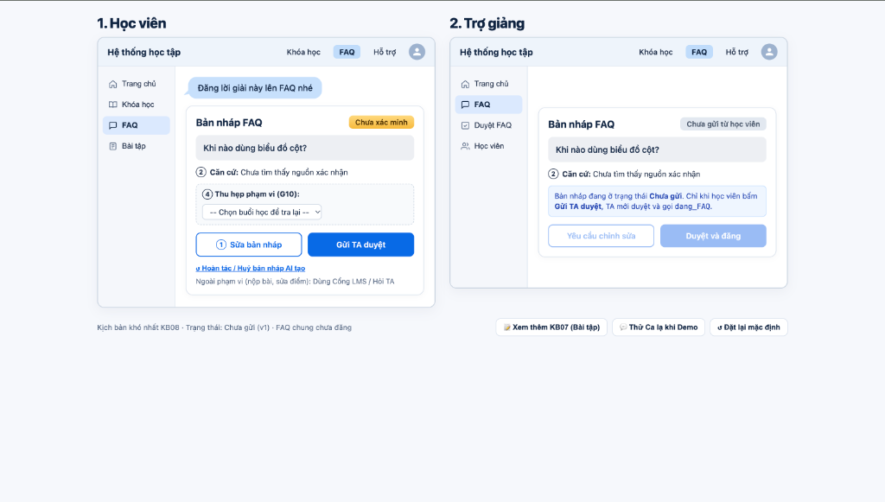
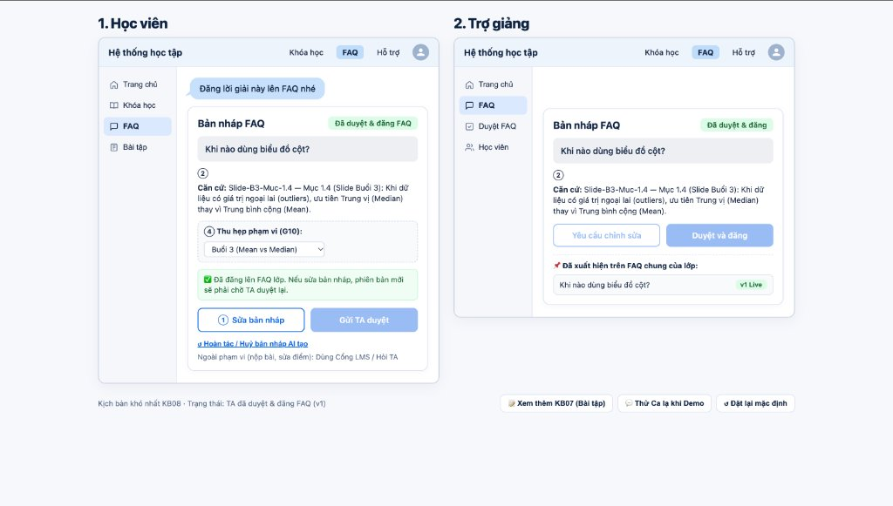

# K5-L3B-Day05-track-HayHoi — Track T2 Giáo dục · Nhóm HayHoi

Bài nộp LAB5: Thiết kế sản phẩm AI cho lúc nó sai và kiểm soát mức tự chủ cho trợ lý học tập khóa học (Study Mode).

- **Tài liệu thiết kế đầy đủ:** [`spec.md`](spec.md)
- **Prototype tương tác (KB08 — Học viên & Trợ giảng):** Mở [`prototype/index.html`](prototype/index.html) trực tiếp bằng trình duyệt (Chrome/Safari/Edge).

## Ảnh màn hình prototype đánh số (`spec.md` §5)

1. **① Sửa bản nháp (G9 — Sửa dễ dàng):** Học viên chỉnh nội dung bản nháp trước khi gửi; nếu sửa sau khi đã gửi hoặc đã duyệt, hệ thống tự thu hồi trạng thái duyệt và yêu cầu TA duyệt lại phiên bản mới.
2. **② Căn cứ & Nhãn *Chưa xác minh* (PAIR — Giải thích & xây dựng niềm tin):** Hiển thị trung thực kết quả `tra_cuu_tai_lieu` chưa tìm thấy nguồn xác nhận hoặc mã mục đã đối chiếu.
3. **③ Chờ TA duyệt (`dang_FAQ` — Cần TA duyệt):** Tách rời thao tác **Gửi TA duyệt** (bên Học viên) và **Duyệt và đăng / Yêu cầu chỉnh sửa** (bên Trợ giảng) để nội dung sai không thể tự đăng lên FAQ chung của lớp.
4. **④ Thu hẹp phạm vi (G10 — Thu hẹp phạm vi khi nghi ngờ):** Học viên chọn buổi học để tra cứu lại khi câu hỏi ban đầu thiếu ngữ cảnh hoặc chưa tìm thấy nguồn.
