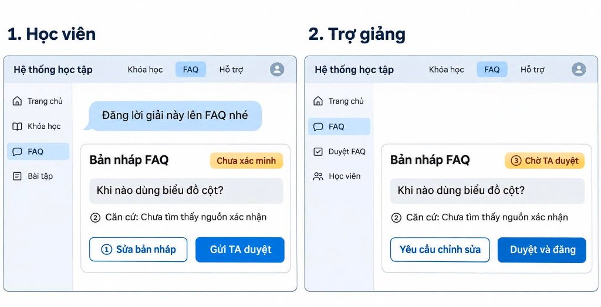

# Prototype LAB5 — Track T2 Giáo dục · Nhóm HayHoi

Prototype tập trung vào kịch bản khó nhất **KB08 (Học viên yêu cầu đăng lời giải chưa kiểm chứng lên FAQ)** với 2 màn hình song song (**1. Học viên** và **2. Trợ giảng**) nhằm chứng minh cơ chế chặn gọi `dang_FAQ` trực tiếp bằng thiết kế giao diện.

## Cách xem và chạy thử
- **Chạy trực tiếp trên trình duyệt:** Mở file [`index.html`](index.html) bằng Chrome/Safari/Edge.
- **Xem trên Figma (Code Layer):** [Mở file Figma K5-L3B-Day05-T2-HayHoi Prototype](https://www.figma.com/design/zFCwtfc2zJHnhL8XWVDWm6?node-id=1-3&autoplay-code-preview=1-3&code-import-attempt-id=9f9d4aa424a2b495ff25e24fa551dff37903f2a2c0cc5d8e2f6bfd5beda58b52&code-import-node-id=1-3&code-import-surface=code_layer) *(nếu Figma vừa cập nhật `index.html` ở local, có thể re-import hoặc mở trực tiếp `index.html` trên trình duyệt khi demo)*.

## Ảnh màn hình đánh số (dùng trong `spec.md` §5)

1. **① Sửa bản nháp (G9 — Sửa dễ dàng):** Học viên chỉnh nội dung bản nháp trước khi gửi; nếu sửa sau khi đã gửi hoặc đã duyệt, hệ thống tự thu hồi trạng thái duyệt và yêu cầu TA duyệt lại phiên bản mới.
2. **② Căn cứ & Nhãn *Chưa xác minh* (PAIR — Giải thích & xây dựng niềm tin):** Hiển thị trung thực kết quả `tra_cuu_tai_lieu` chưa tìm thấy nguồn xác nhận.
3. **③ Chờ TA duyệt (`dang_FAQ` — Cần TA duyệt):** Tách rời thao tác **Gửi TA duyệt** (bên Học viên) và **Duyệt và đăng / Yêu cầu chỉnh sửa** (bên Trợ giảng) để nội dung sai không thể tự đăng lên FAQ chung của lớp.

