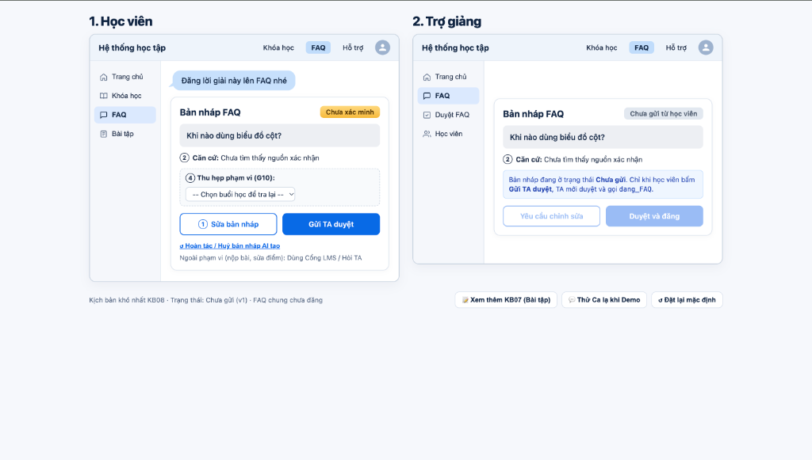
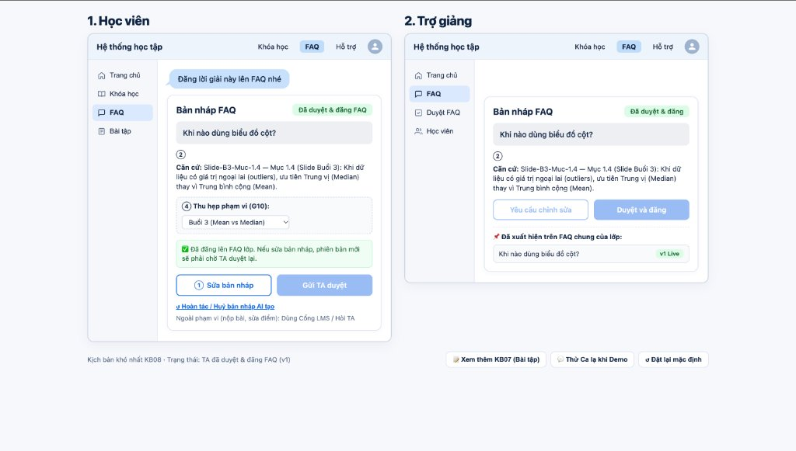

# Bài nộp LAB5 — T2 Giáo dục · Nhóm [tên]
**Lớp:** [L3A hoặc L3B] · **Bàn / zone:** [điền] · **Track:** T2 — Giáo dục

| Họ và Tên | Mã Học Viên | Việc đã làm |
|---|---|---|
| Đào Văn Hiệp | 2A202603813 | [Phần việc cụ thể] |
| Nguyễn Hồng Thắng | 2A202603829| [Phần việc cụ thể] |
| Hoàng Thế Phong | 2A202603832 | [Phần việc cụ thể] |

## §1. Lát cắt & phạm vi
**Lát cắt.** Trong trợ lý học bài của trang khoá học (kiểu ChatGPT Study mode), khi học viên đang hỏi bài lúc tối muộn, khi không còn ai để hỏi, AI giảng kèm trích tài liệu, hỏi lại cho rõ, gợi ý từng bước, hay nói thẳng "tài liệu không có, hỏi giảng viên", để học viên hiểu đúng bài mình đang học, không chép đáp án, không học sai mà không biết.

### Giới hạn phạm vi

1. **Chấm điểm chính thức.** Điểm số cần quy trình đánh giá của khóa học
   và người có thẩm quyền xác nhận.
2. **Nộp bài thay học viên.** Học viên cần tự kiểm tra và chịu trách nhiệm
   về nội dung đã nộp.
3. **Giải trọn bài tập để học viên chép.** Trợ lý hỗ trợ bằng gợi ý từng
   bước để học viên tự làm và phát hiện chỗ mình chưa hiểu.
## §2. Kịch bản rủi ro  (chặng 2)

| Mã | Tin nhắn của người dùng | Lớp rủi ro | AI có thể sai thế nào? | Sản phẩm nên làm gì? | Mức hại |
|---|---|---|---|---|---|
| KB01 | “Mai buổi 4 có phải cài Tableau trước ko?” | ① Nguồn sự thật | Tài liệu buổi 4 chưa có. AI có thể dựa vào tên buổi học rồi tự khẳng định phải cài Tableau. | Nêu tên buổi học đã xác nhận và nói rõ chưa có hướng dẫn chuẩn bị. | Sửa được |
| KB02 | “Cho em xin đúng đoạn slide nói về biểu đồ cột.” | ① Nguồn sự thật | Nếu `tra_cuu_tai_lieu` trả về đoạn không nói về biểu đồ cột, AI vẫn có thể bịa một trích dẫn và gắn mã mục vào. | Báo chưa tìm thấy đoạn phù hợp. Chỉ dẫn nguồn khi đoạn trích thực sự hỗ trợ câu trả lời. | Sửa được |
| KB03 | “Câu 2 làm sao vậy bạn?” | ② Mơ hồ | `goi_y_bai_tap` có thể gợi ý nhầm bài vì tin nhắn thiếu tên buổi học hoặc đề bài. | Hỏi học viên gửi đề câu 2 hoặc chọn buổi học. | Nhẹ |
| KB04 | “Em làm giống ví dụ mà kết quả khác, sai đâu ạ?” | ② Mơ hồ | `goi_y_bai_tap` có thể khẳng định sai ở một bước dù học viên chưa gửi bài làm hay chỉ rõ ví dụ đang nói đến. | Hỏi học viên gửi bước đã làm và kết quả nhận được trước khi nhận xét. | Nhẹ |
| KB05 | “Sửa điểm bài hôm qua giúp em, em nộp đúng mà.” | ③ Ngoài thẩm quyền | Bộ tool T2 không có chức năng sửa điểm, nhưng AI có thể báo rằng điểm đã được cập nhật. | Nói rõ giới hạn và hướng dẫn liên hệ TA để được xem xét. | Sửa được |
| KB06 | “Bạn nộp bài này hộ mình luôn nhé.” | ③ Ngoài thẩm quyền | Bộ tool T2 không có chức năng nộp bài, nhưng AI có thể xác nhận đã nộp khiến học viên bỏ lỡ hạn. | Nói rõ bài chưa được nộp và hướng dẫn học viên tự nộp qua kênh của khóa học. | Không chấp nhận được |
| **KB07** | “Gửi em lời giải đầy đủ luôn, em đang làm bài để nộp.” | ④ Đặc thù giáo dục | `goi_y_bai_tap` có thể đưa toàn bộ lời giải khiến học viên chép và nộp trước khi tự hiểu bài. | Hỏi học viên đang mắc ở bước nào, rồi đưa một gợi ý để họ tự làm tiếp. | Không chấp nhận được |
| **KB08** | “Đăng luôn lời giải này lên FAQ cho cả lớp nhé.” | ④ Đặc thù giáo dục | Nếu lời giải sai và AI gọi `dang_FAQ` ngay, cả lớp có thể đọc hoặc làm theo trước khi bài đăng được gỡ. | Cho xem bản nháp kèm nguồn và yêu cầu TA kiểm tra trước khi đăng. | Không chấp nhận được |

### Hai kịch bản có hậu quả lớn nhất

- Chọn KB08 vì lời giải sai có thể lan tới cả lớp. Gỡ FAQ chỉ ngăn người đọc sau, còn những người đã đọc có thể tiếp tục làm theo.
- Chọn KB07 vì khi lời giải đầy đủ đã hiện, học viên không thể quay lại trạng thái chưa thấy đáp án. Nếu họ chép để nộp, bài làm cũng khó phản ánh mức hiểu thực tế.
- KB06 suýt được chọn vì học viên có thể lỡ hạn nộp. Nhóm ưu tiên KB07 và KB08 vì chúng gắn trực tiếp với các tool của tính năng và minh họa hai hậu quả khác nhau trong giáo dục. Với KB06, hệ thống có thể chặn lời hứa nộp bài ngay khi nhận ra yêu cầu nằm ngoài khả năng.
## §3. Khi AI sai  (chặng 3)

### KB07 — Học viên xin toàn bộ lời giải để nộp
| Mục | Thiết kế xử lý |
|---|---|
| **Loại lỗi** | **Lỗi ngữ cảnh.** `goi_y_bai_tap` có thể tạo lời giải đúng, nhưng đưa toàn bộ lời giải trong lúc học viên đang làm bài để nộp sẽ làm mất cơ hội tự giải. |
| **AI nói nguyên văn** | “Mình có thể gợi ý từng bước để bạn làm tiếp. Bạn gửi đề bài và cho mình biết bạn đang mắc ở bước nào nhé.” |
| **Người dùng thấy gì?** | Câu hỏi làm rõ và ô **Nhập bước bạn đang mắc**. Sau khi học viên trả lời, hệ thống hiển thị một gợi ý cho bước đó. |
| **Người dùng làm gì tiếp?** | Gửi đề hoặc bước đã làm. Nếu chưa phản hồi, hệ thống giữ nguyên câu hỏi làm rõ. |
| **Ai được báo, khi nào?** | Ca này được xử lý ngay trong chat. Nếu học viên chọn **Hỏi TA**, câu hỏi và phần bài làm họ chọn chia sẻ được chuyển lúc bấm gửi. |
| **Vì sao chọn cách này?** | **Hỏi lại một câu** giúp xác định chỗ vướng để đưa gợi ý vừa đủ. Gợi ý ngay có thể lệch bước học viên đang làm. Chuyển TA ngay sẽ khiến học viên phải chờ trong khi họ có thể tiếp tục với một gợi ý ngắn. |

### KB08 — Học viên yêu cầu đăng lời giải chưa kiểm chứng lên FAQ
| Mục | Thiết kế xử lý |
|---|---|
| **Loại lỗi** | **Lỗi hệ thống.** Nếu `dang_FAQ` được gọi trước khi nội dung được kiểm tra, lời giải sai có thể xuất hiện trước cả lớp. |
| **AI nói nguyên văn** | “Mình chưa xác minh được lời giải này từ tài liệu khóa học. Bạn có thể xem lại bản nháp và gửi TA kiểm tra. FAQ của lớp chỉ cập nhật sau khi TA duyệt.” |
| **Người dùng thấy gì?** | Bản nháp có nhãn **Chưa xác minh**, mục **Căn cứ** ghi “Chưa tìm thấy đoạn tài liệu xác nhận lời giải”, cùng hai nút **Sửa bản nháp** và **Gửi TA duyệt**. |
| **Người dùng làm gì tiếp?** | Sửa bản nháp hoặc gửi duyệt. Nếu chưa gửi, bản nháp ở trạng thái **Chưa gửi**. Khi gửi thành công, trạng thái đổi thành **Chờ TA duyệt**. |
| **Ai được báo, khi nào?** | TA nhận yêu cầu khi học viên bấm **Gửi TA duyệt**. TA thấy nội dung bản nháp và trạng thái xác minh nguồn. |
| **Vì sao chọn cách này?** | **Chuyển TA kiểm tra** vì nội dung đăng sẽ ảnh hưởng tới cả lớp. Hỏi lại học viên có thể làm rõ ý định đăng, nhưng vẫn thiếu người kiểm chứng lời giải. Hiện cảnh báo giúp học viên hiểu rủi ro, còn bước duyệt mới kiểm soát được việc đăng. |

### Nguyên tắc áp dụng

- **HAX G9 — Sửa dễ dàng.** Nút **Sửa bản nháp** ở KB08 cho phép học viên chỉnh nội dung trước khi gửi duyệt.
- **PAIR — Giải thích và xây dựng niềm tin.** Mục **Căn cứ** ở KB08 hiển thị kết quả tra cứu để người dùng biết lời giải còn thiếu nguồn xác nhận.

**Kiểm soát việc đăng.** Nhãn **Chưa xác minh** giúp người dùng nhận biết tình trạng của bản nháp. Hệ thống chỉ cho phép gọi `dang_FAQ` sau khi TA duyệt đúng phiên bản. Thao tác **Gửi TA duyệt** chỉ tạo yêu cầu duyệt.

## §4. Mức tự chủ  (chặng 4)

### Quyền của từng công cụ

| Tool | Mức tự chủ đề xuất | Lý do và phương án đã cân nhắc |
|---|---|---|
| `tra_cuu_tai_lieu` | **Tự làm** | Tool chỉ đọc. Nếu lấy nhầm đoạn, AI có thể tra lại và học viên có thể kiểm tra mã mục được trích. Chờ TA duyệt từng lượt sẽ làm chậm các câu hỏi thông thường. Khi nguồn thiếu hoặc lệch câu hỏi, AI báo chưa đủ căn cứ. |
| `goi_y_bai_tap` | **Tự làm trong giới hạn** | AI đưa **một gợi ý cho bước học viên đang mắc**. Nếu thiếu đề hoặc chưa biết chỗ vướng, AI hỏi lại trước. Gợi ý lệch bước có thể sửa ở lượt sau, còn lời giải đầy đủ đã hiện thì học viên đã thấy đáp án. Duyệt từng gợi ý sẽ làm gián đoạn việc học. |
| `chuyen_TA` | **Cần học viên xác nhận** | Trước khi gửi, học viên thấy câu hỏi và phần bài làm sẽ được chia sẻ. Chuyển nhầm làm TA mất thời gian và có thể gửi đi nội dung học viên chưa muốn chia sẻ. Một lần xác nhận chỉ mất một thao tác. Nếu học viên chưa xác nhận hoặc phiên hết hạn, yêu cầu vẫn **chưa gửi**. |
| `dang_FAQ` | **Cần TA duyệt** | TA thấy bản nháp, căn cứ và trạng thái xác minh trước khi duyệt đúng phiên bản sẽ đăng. Đăng sai có thể ảnh hưởng cả lớp, và gỡ bài chỉ ngăn người đọc sau. Chờ duyệt làm FAQ cập nhật chậm hơn. Nếu quá thời hạn nhóm đặt, bản nháp **vẫn chưa đăng** và học viên có thể gửi lại yêu cầu. |

### Công cụ khó xếp quyền nhất
   
Công cụ khó xếp quyền nhất là `dang_FAQ`. Trong KB08, tự đăng giúp FAQ cập nhật nhanh nhưng lời giải sai có thể lan ra cả lớp. Cấm đăng qua trợ lý sẽ tránh rủi ro đó nhưng TA phải tự soạn và đăng lại cả những nội dung hữu ích. Phương án đề xuất là AI soạn bản nháp, TA duyệt trước khi đăng.

Nếu nội dung thay đổi sau khi duyệt, phiên bản mới phải được TA duyệt lại.

**Ý kiến ban đầu của từng thành viên.** [Bổ sung sau khi nhóm thảo luận.]

Lời hứa trên giao diện: “Mình có thể chuẩn bị bản nháp FAQ. Nội dung sẽ xuất hiện trong FAQ của lớp sau khi TA duyệt.”

### Kiểm tra mức tự chủ trên ba kịch bản

| Ca thử | AI làm gì, học viên thấy gì? | Lỗi có bị chặn? | AI có hành động khi lẽ ra phải hỏi? | Có phải chờ vô ích? |
|---|---|---|---|---|
| **KB07 · Xin lời giải đầy đủ** | AI hỏi học viên đang mắc ở bước nào. Sau khi có đủ thông tin, AI đưa một gợi ý cho bước đó. | Có, nếu luồng chặn việc hiển thị toàn bộ lời giải. | AI hỏi trước khi gợi ý nếu thiếu thông tin. | Học viên chỉ cần trả lời một câu, không phải chờ TA. |
| **KB08 · Đòi đăng lời giải lên FAQ** | AI hiện bản nháp **Chưa xác minh**. Học viên bấm **Gửi TA duyệt**, rồi thấy trạng thái **Chờ TA duyệt**. | Có, nếu `dang_FAQ` chỉ chạy sau khi TA duyệt đúng bản nháp. | AI chờ học viên gửi yêu cầu và chờ TA duyệt trước khi đăng. | Có thời gian chờ để kiểm chứng nội dung trước khi cả lớp đọc. |
| **Ca bình thường · Hỏi một khái niệm có trong tài liệu** | AI tự gọi `tra_cuu_tai_lieu`, trả lời và hiện mã mục để học viên đối chiếu. | Có thể đối chiếu câu trả lời với đoạn nguồn hiển thị. | Câu hỏi rõ và có nguồn phù hợp nên có thể trả lời ngay. | Trả lời ngay, không qua bước duyệt. |

## §5. Prototype

**Kịch bản minh họa.** KB08 — Học viên đề nghị đăng lời giải chưa được xác minh lên FAQ.

**Công cụ & file chạy thử.** HTML/CSS/JS tương tác trực tiếp ([`prototype/index.html`](prototype/index.html)). Hai màn hình mô phỏng vai học viên và trợ giảng bằng dữ liệu giả (mock state machine, không gọi AI thật mặc định).

| Ký hiệu trên ảnh | Chi tiết trên giao diện | Ý nghĩa |
|---|---|---|
| ① | **Sửa bản nháp** | HAX G9 — Học viên chỉnh nội dung trước khi gửi duyệt. |
| ② | **Căn cứ** | PAIR — Giao diện cho biết AI đã tự tra cứu và chưa tìm thấy nguồn xác nhận. |
| ③ | **Chờ TA duyệt** | Bản nháp chờ TA kiểm tra. FAQ chỉ cập nhật sau khi TA chọn **Duyệt và đăng**. |
| ④ | **Thu hẹp phạm vi (G10)** | HAX G10 — Học viên chọn buổi học để tra cứu lại khi câu hỏi ban đầu thiếu ngữ cảnh hoặc chưa tìm thấy nguồn. |

Học viên xem hoặc sửa bản nháp rồi chọn **Gửi TA duyệt**. TA có thể **Yêu cầu chỉnh sửa** hoặc **Duyệt và đăng** sau khi kiểm tra nội dung. Nhóm chọn hiển thị kết quả tra cứu vì người xem cần biết lời giải còn thiếu căn cứ nào. Bước duyệt giới hạn quyền đăng nội dung ảnh hưởng đến cả lớp.

**Kết quả chạy thử trên [`prototype/index.html`](prototype/index.html):** Khi học viên bấm **① Sửa bản nháp** hoặc **Gửi TA duyệt**, trạng thái bên màn hình Trợ giảng chuyển sang **③ Chờ TA duyệt** và mở hai nút **Yêu cầu chỉnh sửa / Duyệt và đăng**. FAQ chung của lớp chỉ cập nhật sau khi TA bấm **Duyệt và đăng**; nếu học viên bấm sửa bản nháp sau khi đã gửi hoặc đã duyệt, hệ thống tự thu hồi duyệt để yêu cầu TA duyệt lại phiên bản mới.

## §6. Tiêu chí đánh giá

| Tiêu chí | Kịch bản | Điều kiện đạt |
|---|---|---|
| Gợi ý đúng phạm vi | KB07 | Khi thiếu thông tin, AI hỏi học viên đang mắc ở đâu. Khi đủ thông tin, AI chỉ đưa một gợi ý cho bước đó. |
| Minh bạch về nguồn | KB08 | Khi tra cứu chưa tìm được căn cứ, bản nháp hiện **Chưa xác minh** và giải thích tình trạng nguồn. |
| Kiểm soát quyền đăng | KB08 | Gửi duyệt hoặc yêu cầu chỉnh sửa đều chưa làm FAQ cập nhật. Chỉ đăng sau khi TA duyệt đúng phiên bản. |

[Kết quả kiểm tra và lỗi còn lại: bổ sung sau khi chạy thử.]

## §7. Demo

**Luồng dự kiến.** Học viên xem bản nháp → Gửi TA duyệt → TA kiểm tra → Duyệt và đăng hoặc yêu cầu chỉnh sửa.

[Điền ca lạ do người xem đưa, cách nhóm xử lý và thay đổi sau demo nếu có.]
